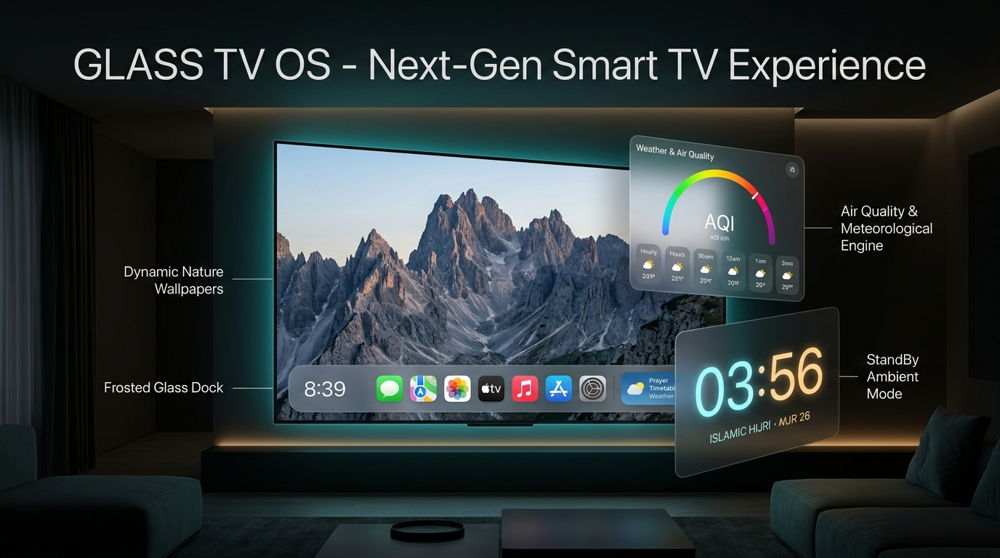
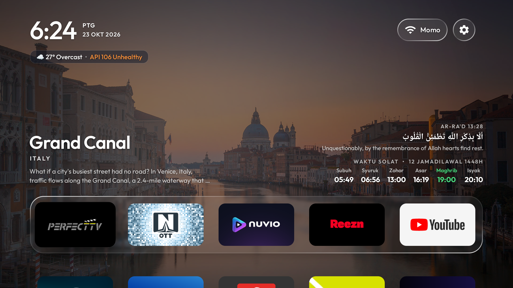
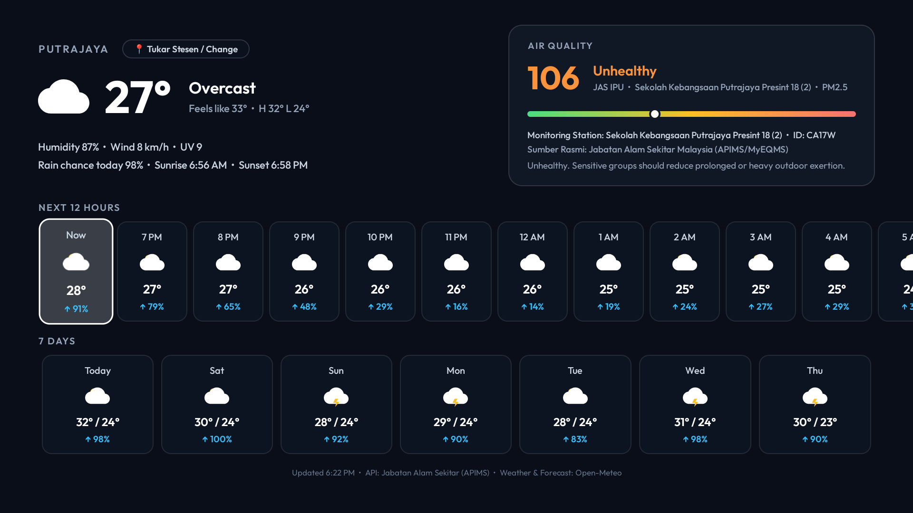
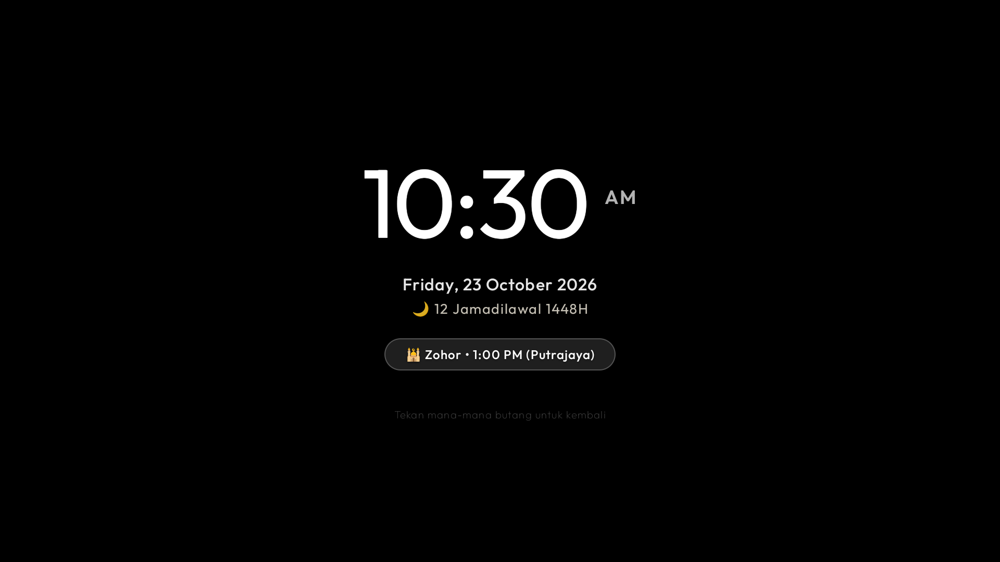
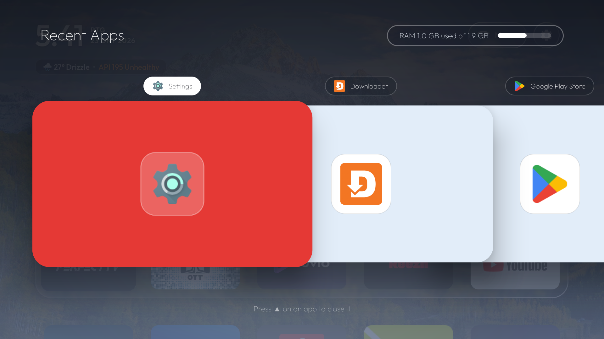
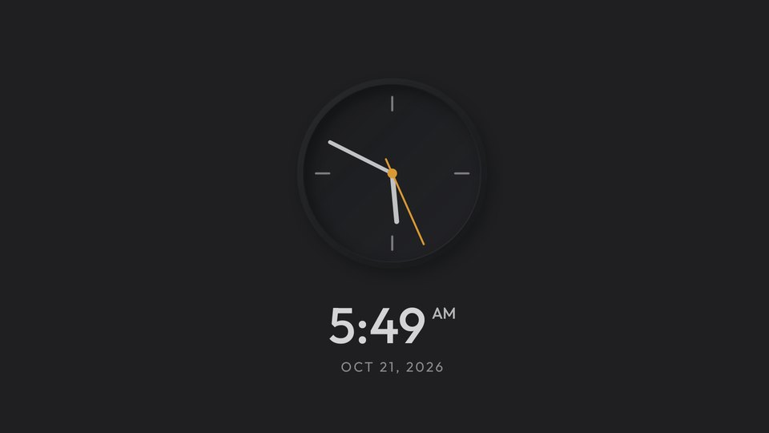

# Glass TV

**Make your Android TV or Google TV fast and ad-free again: strip out the bloat and ads, free up memory,
and come home to just your apps, with a new place to visit behind them every week.**

<p align="center">
  
</p>

<p align="center">
  <a href="https://github.com/aqmangge/glass-tv-home/raw/main/release/glass-tv-home.apk">
    
  </a>
</p>

> 📦 **Direct APK Download**: Get the latest prebuilt [**`release/glass-tv-home.apk`**](https://github.com/aqmangge/glass-tv-home/raw/main/release/glass-tv-home.apk) (**v2.6.0** • ~504 KB) ready to install on any Android TV or Google TV!
>
> 🎨 **Interactive Design Presentation Poster**: Open [`docs/poster.html`](docs/poster.html) in any browser for the complete UI/UX specifications, design tokens, and printable poster deck.
>
> 📖 **User Guides / Panduan Pengguna**:
> - 🇬🇧 **English User Guide**: Complete beginner walkthrough, 1-line AI setup, remote navigation, phone setup & FAQ in [USER_GUIDE.md](USER_GUIDE.md).
> - 🇲🇾 **Panduan Bahasa Melayu**: Panduan lengkap langkah demi langkah untuk pengguna baru di [PANDUAN_PENGGUNA.md](PANDUAN_PENGGUNA.md).

Glass TV debloats any Android TV or Google TV over Wi-Fi, with no root and nothing that can't be undone, then
swaps the ad-filled home screen for a light one in frosted glass, with a new set of places behind your apps
every week.

<p>
  
  
  
  
</p>

## What you get

- **Recent Apps & RAM Manager (Double-Press Home).** A native tvOS-style 3D CoverFlow app switcher and memory optimizer:
  - **Double-Press Home Button**: Double-pressing the remote's Home button from anywhere on the TV brings up the frosted glass Recent Apps deck.
  - **Double-Press Home to Close All**: Double-pressing Home again while inside the Recent Apps screen triggers `Close All` immediately—killing all background tasks and clearing memory in one step!
  - **Genuine Force-Stop Automation**: Integrates Accessibility automated force-stop to cleanly and completely terminate even stubborn foreground media apps (e.g. video players, streaming apps) that resist standard background process termination.
  - **Live RAM Gauge**: Real-time memory consumption display (`RAM 1.8 GB used of 2.3 GB`) with a sleek recessed progress bar.
  - **Individual App Dismissal**: Press `▲ (Up)` on any app card to slide it away, force-stop its process, and immediately reclaim RAM.
  - **Close All Button**: Click the circular `Close All` button (`🗑️`) at the end of the carousel to kill all running apps at once.
- **Weather & Air Quality Engine.** A full-screen Leanback weather hub (`WeatherActivity`) accessible directly from the under-clock pill:
  - Current condition, apparent temperature, humidity, wind velocity, UV index, sunrise and sunset times.
  - Air Quality Index (AQI / API / IPU) from Malaysia's Jabatan Alam Sekitar (APIMS) with a multi-color spectrum gauge, station comparisons, PM2.5 / PM10 readings, and health advisories.
  - Next 12 Hours hourly forecast pills and 7-day daily forecast cards with precipitation probabilities.
- **Islamic Prayer Timetable & Daily Ayat.** A mindful cultural shelf:
  - 6-phase timetable (Subuh, Syuruk, Zohor, Asar, Maghrib, Isyak) with emerald highlighting for the active prayer window.
  - Daily Quranic Ayat of the Day with Arabic calligraphy and translations.
- **StandBy Ambient Mode & Smart Energy Lifecycle.**
  - **10 Minutes Idle**: Automatically engages an ambient StandBy screensaver with large 110sp numerals, Islamic Hijri calendar, next prayer capsule, and a late-night red monochrome wind-down mode.
  - **2 Hours Later**: Automatically turns off the TV display into deep sleep standby via Android's Accessibility Service (`GLOBAL_ACTION_LOCK_SCREEN`).
- **Frosted Glass Settings Dropdown & 4K Wallpaper Categories.**
  - **Floating Glass Dropdown**: Clicking the top Settings icon (`⚙️`) opens a native Apple tvOS-style glass menu under the button.
  - **Dynamic 4K Wallpaper Switcher**: Switch themes on the fly between *Natural*, *🇲🇾 Malaysia (Koleksi 14 Negeri & Wilayah)*, *Skyscraper* (KLCC, Manhattan, Chicago, Dubai, HK), *Deep Space*, *Ocean & Coastal*, *Minimalist Dark*, or trigger *Next Wallpaper*.
  - **🇲🇾 Malaysia 14 States Sub-Dropdown**: Dedicated sub-dialog to choose wallpapers specifically for any of Malaysia's 14 states (Johor, Kedah, Kelantan, Melaka, Negeri Sembilan, Pahang, Perak, Perlis, Pulau Pinang, Sabah, Sarawak, Selangor, Terengganu, Wilayah Persekutuan) or rotate all states together.
  - **Built-in Haze & Prayer Zone Selectors**: Select from 30+ Malaysian DOE (JAS APIMS) air quality stations and 35+ official JAKIM prayer zones without needing a computer or AI.
  - **All Settings Shortcut**: Access standard Android TV settings in one click (or by long-pressing Settings).
- **Phone QR Wallpaper Upload & Gallery Manager (Phone-to-TV).**
  - **Instant QR Code Wi-Fi Upload**: Scan the QR code on TV with any phone to open a frosted glass web uploader. Send personal high-res wallpapers straight to TV with zero third-party cloud apps.
  - **Full Mobile & TV Photo Manager**: Manage uploaded wallpapers directly on mobile or TV with remote D-pad. Lock a single picture as permanent wallpaper (`📌 Single Mode`), switch back to rotating slideshow (`🔄 Putar Semua`), or delete unwanted pictures (`🗑️`).
  - **Clean View for Custom Wallpapers**: Description/hero text shelf is automatically hidden (`View.GONE`) for custom wallpapers so personal photos remain 100% unobstructed.
- **Console Sound Effects & Mute Toggle (PS5, Nintendo Switch, Xbox).**
  - **3 Iconic Console Profiles**: Choose your favorite sound profile from the Settings menu (`⚙️`):
    - **PlayStation 5**: Futuristic soft swooshes and acoustic tactile clicks.
    - **Nintendo Switch**: Crisp mechanical snap and bright affirmative chime.
    - **Xbox Series X/S**: Resonant warm mid-bass navigation blips and two-tone modern rising chime.
  - **Mute / Silent Mode (`Off`)**: Toggle sound effects completely off for a whisper-quiet late-night browsing experience.
  - **Live Audition**: Plays instant sound previews upon selecting an option in the dialog.
  - **Persistent Memory**: Saved across reboots and app launches via TV shared preferences.
- **OTA In-App Auto Update & 1-Line AI Patching.**
  - **In-App OTA Check (`⚙️ Check for Updates`)**: Check, download, and install latest APK patches directly on the TV without a PC.
  - **Background Launch Check**: Glass TV silently checks for new releases on startup and prompts when a new update is ready to install.
  - **1-Line AI Update Prompt**: Paste `update patch latest glass tv dekat tv rumah saya: https://github.com/aqmangge/glass-tv-home` to any AI coding assistant to upgrade via ADB in 5 seconds without touching existing user data.

- **Keeps itself clean.** Every 15 days, while Home sits idle, the TV clears its app caches, where the Play
  Store leaves gigabytes of download leftovers that can make apps open to a blank screen. No computer needed,
  sign-ins and app data are never touched; the TV asks once to allow it.
- **Glass, like Apple's.** The dock's tray, the top-bar buttons and the menus show the picture behind them
  softened, with a shine along their edges. Android 10 has no live blur, so the picture is blurred once each
  time it changes and the glass draws its patch of it.
- **One selection that glides.** Between apps it is a pane of glass with the app's shadow under it; on the top
  bar and in the menus it is dark. It glides and changes shape from one to the next, never jumps.
- **Places to visit that renew themselves.** Once a week the TV takes the pictures Bing has shown on its home
  page over the past days — landmarks, landscapes, wildlife — deletes last week's and rotates through them,
  dimmed so the clock and tiles stay readable. The shelf above the dock names each one, its country and a few
  lines about it. Pictures with people in them are skipped: by the words in their caption, and by Android's
  own face detector on the TV. No key, no account, nothing to set up.
- **Every app tints the room.** The glow behind Home, and the glass with it, blends to the colour of whichever
  app is selected.
- **Arrange your apps from the remote.** Hold OK on an app for a glass menu with **Move** and **App info**.
  Move picks the app up: it wiggles, the arrows carry it (into or out of the dock too) and the other apps
  slide aside; OK puts it down. The order is kept, and apps installed later join at the end.
- **An Inputs menu in glass.** The selection glides out of the Inputs button into the list of HDMI and AV
  inputs, and Up from the top of the list glides it back.
- **Comes back as you left it.** Back from an app, the app you left is still selected; pressing Home on Home
  goes to the first app. When Android has closed Home to free memory, it comes back whole in one frame,
  with no black screen and no half-built dock.
- **A clock screensaver.** A grey analog dial with a yellow-orange second hand that ticks, the time and
  date beneath, drifting a little each minute so nothing burns in.
- **Rows feather out under the top bar** instead of being cut off when you scroll, and the Wi-Fi / Ethernet
  button can be hidden (`show_network_pill`).
- **Rotating wallpapers of your own** instead, with `"places": false`: put pictures in a theme's `wallpapers/`
  folder and choose how often they change, down to every 5 seconds. Each picture is decoded in the background
  and cross-faded.

| | |
|---|---|
|  |  |
| *Home, with this week's place* | *Every app, feathering out under the top bar* |
|  |  |
| *Inputs, in glass* | *The clock screensaver* |

Still light: on a Xiaomi Mi TV with 1.8 GB of RAM the launcher uses about 80–100 MB and stays there over hours
of use, one wallpaper is in memory at a time, the week's places take about 2 MB of storage, and nothing runs
while you are inside an app.

## Setting it up (Auto with AI or Manual)

### 🤖 1-Line AI Setup (Easiest & Automatic)
Using an AI assistant (**Google Antigravity** [Free], **Claude Code** [Paid], **Cursor**)?
1. On your TV remote, go to **Settings ⚙️ $\rightarrow$ About $\rightarrow$ click Build 7 times** to enable Developer Options, then turn ON **USB debugging** & **Wireless/Network debugging**.
2. Paste this single line to your AI assistant:
   ```text
   install ni dekat tv rumah saya: https://github.com/aqmangge/glass-tv-home
   ```
   *(Or in English: `install this on my home tv: https://github.com/aqmangge/glass-tv-home`)*
3. The AI will automatically ask for your TV IP & location in Malaysia, connect over Wi-Fi, backup, debloat ads & tracking, and install Glass TV Home! See [PANDUAN_PENGGUNA.md](PANDUAN_PENGGUNA.md) and [USER_GUIDE.md](USER_GUIDE.md).

### 🔄 1-Line AI Update / Patch Prompt (For Existing Users)
Already have Glass TV installed and want to update to the latest release or patch? Paste this single line to your AI:
```text
update patch latest glass tv dekat tv rumah saya: https://github.com/aqmangge/glass-tv-home
```
*(Or in English: `update glass tv to the latest patch on my tv: https://github.com/aqmangge/glass-tv-home`)*

> 🚨 **AI Update Rule / Arahan Khas AI Kemas Kini**:
> When a user requests to update/patch Glass TV:
> 1. Connect to the TV over Wi-Fi (`adb connect <TV_IP>:5555`).
> 2. Install the latest prebuilt APK without wiping user data (`adb install -r release/glass-tv-home.apk`).
> 3. Relaunch the launcher (`adb shell am start -n com.gathin.tvhome/.MainActivity`).
> 4. All personal wallpapers, dock orders, and settings are 100% retained!

> 🚨 **AI Assistant Rule / Arahan Khas AI**:
> When installing for a user, the AI **must ask the user for their location in Malaysia** (e.g. Putrajaya, Cheras, Shah Alam, Melaka, JB, Penang, Kuantan, Kuching, KK) to configure live JAS haze/IPU data and JAKIM prayer times via:
> ```bash
> adb shell am broadcast -a com.gathin.tvhome.SET_LOCATION -p com.gathin.tvhome --es query "<LOCATION>"
> ```
> If installed manually without AI, users can change the station at any time directly on the TV using the remote control under **Settings (⚙️) $\rightarrow$ Location API Haze** or **Weather Dashboard $\rightarrow$ 📍 Tukar Stesen / Change**.

> 📖 **Read the Beginner User Guides**:
> - 🇬🇧 **[USER_GUIDE.md](USER_GUIDE.md)**: Full English step-by-step guide (Developer Mode, AI prompts, manual station selector, iPhone & Android setups, FAQ).
> - 🇲🇾 **[PANDUAN_PENGGUNA.md](PANDUAN_PENGGUNA.md)**: Panduan penuh Bahasa Melayu untuk pengguna baru (aktifkan Developer Mode, arahan AI, tukar stesen manual remote TV, telefon pintar & FAQ).

The full step-by-step guide for debloating and installing is in
[docs/CLEANYOURTV-README.md](docs/CLEANYOURTV-README.md), and [PROMPT.md](PROMPT.md) lets a coding assistant do
it for you. In short:

```bash
python3 -m venv tools/venv && tools/venv/bin/pip install -r tools/requirements.txt
export TV_HOST=192.168.1.50                                   # your TV's IP address
tools/disable.sh examples/<your tv>/debloat.txt               # debloat
launcher/build-and-install.sh                                 # build the launcher and make it Home
tools/theme.sh themes/<your theme>                            # push your settings and wallpapers
```

Glass TV clears the TV's caches by itself every 15 days ([how](docs/cache-clean.md)). To clean several TVs
from one computer instead, [`tools/cache-clean.sh`](docs/cache-clean.md) finds the TVs on your network and
clears their caches, leaving sign-ins and app data untouched.

## Which TVs work

Android TV and Google TV, Android 8 or newer, on the TV or on a box plugged into any TV.
[docs/DEVICES.md](docs/DEVICES.md) lists every tested model and how far each was tested: end to end with
Glass TV, with the original launcher, or debloat only, plus what is expected to work and what cannot.

### 🇲🇾 Unifi TV Box (TM Unifi Plus Box) Compatibility & Warranty
- **Can I use it on Unifi TV Box?** **Yes!** Unifi Plus Box (Skyworth HP40A3, ZTE B866V2K, and newer TM Android TV boxes) runs certified Android TV. You can install Glass TV Home via APK sideloading or wireless ADB. The official **unifi TV** app remains fully operational so you never lose live TV channels or subscriptions.
- **Will it void the warranty?** **No, it will NOT void your warranty.** Glass TV Home is a standard user-space Android APK. It does **not** root the box, unlock the bootloader, or modify system firmware. You can uninstall it at any time from *Settings > Apps > Glass TV Home > Uninstall* or factory reset the box to return it 100% to its original TM factory state.

## LG and Samsung TVs

LG TVs run webOS and Samsung TVs run Tizen; neither can run Android apps, and neither lets any app replace its
home screen or the Home button. For the full Glass TV, plug in a Google TV or Android TV box (Chromecast with
Google TV, Xiaomi Mi Box, NVIDIA Shield): the TV becomes the screen and Glass TV is Home. On LG, a version you
open as an app is in preview in [webos/](webos/README.md).

## Places, or pictures of your own

Places are on from the start. To change how often the picture changes, or to use your own pictures and keep
the launcher offline, make a theme folder with a `config.json` like this and push it with `tools/theme.sh`:

```json
{
  "places": false,
  "wallpaper_seconds": 15,
  "show_network_pill": false
}
```

All keys are listed in [themes/README.md](themes/README.md). With `"places": false`, the launcher never goes
online.

## Credits and licence

- Built on [CleanYourTV](https://github.com/Gathin23/cleanyourtv) © 2026 Gathin, MIT licence — see
  [LICENSE](LICENSE). Its debloat lists, tools and launcher are the foundation of this project.
- The Outfit typeface is under the SIL Open Font License (`launcher/FONT-LICENSE-OFL.txt`).
- The Inputs icon is from Google's Material Icons (Apache 2.0).
- Pictures of places and their captions are Bing's daily images (Microsoft). The launcher fetches them on your
  own TV; the promo pictures above show three of them.
- Gotham, used in the promo pictures only, is a Hoefler&Co. typeface and is not part of this repository.
